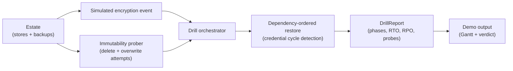

# lastknowngood

A recovery drill harness that measures your real RTO and proves backup immutability by attacking the backups, inside a sealed in-process lab.

[](https://github.com/SlateGitOrg/lastknowngood/actions/workflows/ci.yml)

## Why

Every organisation claims a four-hour recovery objective. Almost none has restored under realistic conditions, so the first real attempt is also the first test, and it tends to reveal that the backups were encrypted too, that the restore takes far longer than planned, or that the credentials needed to start a service live in the service that is down. A recovery plan is fiction until it has been run. lastknowngood runs it: it executes a scripted restore with per-phase timing, measures the achieved RPO, and checks immutability by trying to delete and overwrite the backup instead of reading a configuration flag.

## Features

- **Drill orchestrator** that executes a full restore with wall-clock cost per phase and reports the delta against the claimed RTO.
- **Immutability prober** that attempts deletion and overwrite of every backup and compares the result with what the configuration claims.
- **Achieved-RPO measurement** from the gap between the chosen backup and the event, plus the number of records that existed before the event but are missing from the backup.
- **Dependency-order discovery**: stores restore in dependency order, and a credential cycle (store A needs a secret held in store B and vice versa) is detected, charged as a break-glass scramble, and named in the report.
- **Phase-by-phase Gantt** of the drill, with start and end offsets.
- **Attack on the backups**: the simulated encryption event also corrupts any backup whose lock is not actually enforced, because real ransomware goes for backups first.

## Architecture



`src/lab.py` holds the estate: stores of records, point-in-time backups with an `object_lock` claim and a separate `lock_enforced` reality, the simulated encryption event, and the prober. `src/drill.py` runs the drill: probe the backups, pick the newest usable one, restore stores in dependency order, and compute the report. `src/demo.py` runs three drills and prints the results. Everything runs in memory on the standard library.

## Quick start

Requires Python 3.11 or newer. There are no dependencies to install.

```bash
git clone https://github.com/SlateGitOrg/lastknowngood.git
cd lastknowngood
python -m unittest discover -s tests -v   # run the tests
python -m src.demo                        # run three drills and print the report
```

## Example

`python -m src.demo` runs three drills against the same four-store estate (vault, app_db, file_share, config). Trimmed output:

```text
  DRILL 1 - as the runbook describes it
    immutability probe: claims=True  actual=ENFORCED
    resolve_credentials          1h 55m   7h 55m
    claimed RTO   4h 00m
    measured RTO  10h 00m   <- MISSED
    achieved RPO  0h 57m (12 records lost)

  DRILL 2 - after breaking the credential cycle
    claimed RTO   4h 00m
    measured RTO  4h 00m   <- MET

  DRILL 3 - object lock configured but not enforced
    immutability probe: claims=True  actual=NOT ENFORCED   <- claim does not match reality
    RECOVERY FAILED: no usable backup: every copy was reachable from the compromised credentials
```

Drill 1 shows six hours lost to a credential dependency nobody had documented. Drill 2 shows the same estate once the cycle is broken. Drill 3 shows a lock that is claimed but not enforced: the probe deletes the backup, and the drill cannot recover.

## How it works

- **Phase costs are explicit.** `PHASE_COSTS` in `src/drill.py` lists the simulated duration of each phase (declare incident, locate backup, provision infrastructure, restore per store, verify, cutover), and `CREDENTIAL_SCRAMBLE_SECONDS` sets the cost of resolving a credential deadlock. They are assumptions you can change; the measured RTO is the sum of the phases that actually ran.
- **Probe before relying.** The drill probes every backup first. A drill that assumes the backups are good only measures the happy path.
- **Immutability is attempted, not read.** The prober tries to delete and overwrite each backup and records whether each attempt was blocked. `claim_matches_reality` is false when the configuration says immutable and the attempt succeeds.
- **Restore ordering.** Each pass restores every store whose `depends_on` stores and credential source are already restored. If a pass makes no progress, the drill records a `resolve_credentials` phase for the stuck store and continues.
- **RPO in two units.** `achieved_rpo_seconds` is the time window of lost writes; `lost_records` is the same loss in rows, which is the number a business owner can price.

## Testing

```bash
python -m unittest discover -s tests -v
```

The 14 tests assert behaviour, not just execution:

- measured RPO equals the known loss window, and writes after the backup count as lost;
- a genuinely locked backup survives the probe, a misconfigured lock is reported as false, and an unlocked backup is reported honestly;
- the encryption event destroys unprotected backups, a locked backup survives, and restored data is the pre-event data;
- restores respect dependency order, a credential dependency adds measurable time, and a true deadlock is measured rather than hidden;
- the measured RTO can exceed the claimed one, and the Gantt accounts for the whole window.

## Project layout

```text
src/
  lab.py     # estate, stores, backups, simulated encryption event, immutability prober
  drill.py   # drill orchestrator, phase model, DrillReport
  demo.py    # three-drill demonstration
tests/
  test_drill.py
docs/
  ARCHITECTURE.md
```

## Limitations

- The lab is an in-memory simulation. There is no real object store, database or restore; phase durations are configured costs, not measurements of real systems.
- The simulated encryption event overwrites dictionary entries inside the process. It has no filesystem or network access and no propagation logic. This is a resilience-measurement tool, not malware, and it does not apply to any system outside the lab.
- The prober models immutability as two booleans (`object_lock`, `lock_enforced`). Real object-lock semantics (retention modes, legal holds, bucket versus object scope) are out of scope.

## License

MIT — see [LICENSE](LICENSE).
