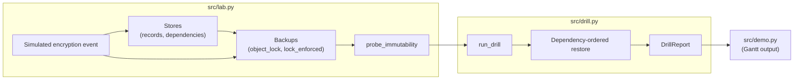

# Architecture

## Context

Recovery objectives are usually written down and rarely tested. lastknowngood replaces the document with a drill: it builds a small estate, simulates a destructive event, restores from backup, and reports what the restore actually cost.

## Container view

## Key decisions

- **Probe instead of read.** Backup immutability is established by attempting deletion and overwrite. Reading a flag reports intent; the attempt reports behaviour. The cost is that the probe is destructive when the lock is not enforced, which is the intended result.
- **Attack the backups.** The simulated event corrupts any backup whose lock is not enforced. A drill that leaves backups untouched measures the easy case.
- **Explicit phase costs.** Durations live in one table (`PHASE_COSTS`) so every assumption is visible and adjustable. The trade-off is that the RTO is a model of the process, not a stopwatch on real infrastructure.
- **Credential cycles are first-class.** A store that needs a credential from a store that is itself down is the most common reason a paper recovery overruns. The drill detects the stall and charges a break-glass phase instead of failing silently.
- **Standard library only.** No dependencies keeps the drill reproducible anywhere Python 3.11 runs.

## Failure modes

- No usable backup (all deleted or corrupted): the report sets `blocked_by` and `restored` stays false; the demo prints the RTO as unbounded.
- Unresolvable dependency cycle after the guard limit: `blocked_by` is set and the drill stops.
- Backup missing a store: the store restores from nothing and the loss shows up in `lost_records`.

## Scope and safety

Everything runs in one process on in-memory data. The encryption event rewrites dictionary entries; there is no filesystem or network access and no propagation logic. Out of scope: real storage backends, real restore tooling, retention modes and legal holds, and any use against systems outside the lab.
